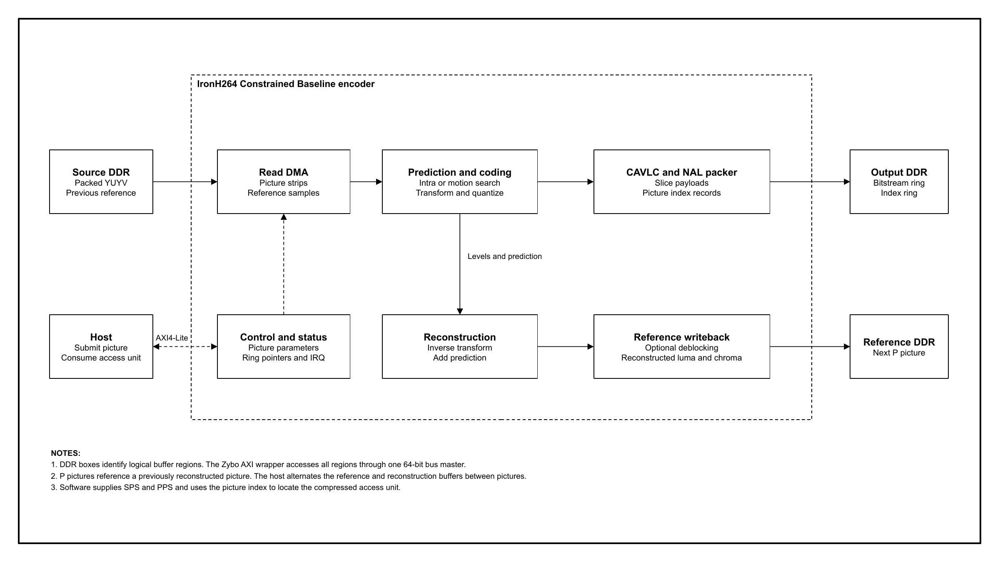

# IronH264 integration and design guide

IronH264 encodes DDR-backed YUYV pictures as progressive H.264 Constrained Baseline. The encoder reads source and reference pictures, reconstructs the next reference, and writes Annex B data and indices into DDR. The host submits work and owns buffer lifetime. A transport application packages the finished access units.

This README is the Markdown design guide for engineers and AI coding assistants such as Claude and Codex. Use the ownership table to locate the RTL, firmware API, Linux ABI and matching tests before changing an interface. For the customer-facing document see the [IronH264 Specification (PDF)](documentation/ironh264_specification.pdf) or its [Markdown source](documentation/ironh264_specification.md).



[Editable architecture slide](documentation/assets/architecture.pptx) · [Drawing source](documentation/diagrams/src/architecture.js)

## Design ownership

| Integration task | Authoritative implementation | What a change must preserve |
|---|---|---|
| Connect the Zybo-style AXI peripheral | [Single-engine wrapper](ip/rtlnet_h264_enc/hdl/ironh264_axi.v) | Separate AXI4-Lite control and encoder clock/reset pairs, a 64-bit AXI4 master and a completion interrupt. |
| Configure independent engines, coding tools or memory widths | [Encoder top](ip/rtlnet_h264_enc/hdl/rtlnet_h264_top.sv), [ordered source list](ip/rtlnet_h264_enc/hdl/rtlnet_h264_enc.f) | Each engine owns its rings and picture band. Match slice allocation to engine count. |
| Change registers or bare-metal operation | [Register definitions](ip/rtlnet_h264_enc/driver/rtlnet_h264_enc.h), [control API](ip/rtlnet_h264_enc/driver/rtlnet_h264_enc_ctl.h), [rate-control guide](ip/rtlnet_h264_enc/documentation/rtlnet_ratectl.md) | Preserve discovery, compatible register behavior, ring ownership and completion in polled and IRQ modes. |
| Integrate capture or Linux userspace | [Linux adapter](linux/ironh264_linux.c), [ioctl definition](linux/ironh264_ioctl.h) | Single-engine capability, DMA-BUF mapping, bounded output, caller-owned file descriptor. |
| Modify coding or prediction | [RTL and packet formats](ip/rtlnet_h264_enc/documentation/rtlnet_h264_enc.md), [encoder benches and decoder harness](ip/rtlnet_h264_enc/testbench/) | Independent decoders must reproduce the reference reconstruction across IDR and P pictures. |

## Hardware integration

For a single-engine AXI peripheral, compile the ordered encoder sources and include the wrapper. Connect `s_axi_aclk` and `s_axi_aresetn` to the register domain. Connect `enc_clk` and `enc_resetn` to the memory master domain. Route the interrupt to the host and map a register aperture covering all implemented registers. Supply DMA memory accessible by the master at 32-bit byte addresses. The Zybo reference connects the encoder to HP3 at 121.85 MHz for 1080p30. Board clocking, reset sequencing, DDR mapping and interrupt routing belong to the board integration.

The Baseline file list includes the High Profile simulation stand-in. The delivered High Profile build uses the core file list, matching black box and device-specific netlist. Keep exactly one implementation of the extension in the elaborated design. Shared `cores/rtlnet_common` sources resolve from RTLNet. In the RTLNet checkout, run `scripts/resolve_media.ps1` to bind the sibling core trees before invoking legacy file lists or test scripts through the resulting `ip/` paths.

## DDR allocation and ring protocol

| Region | Layout and ownership |
|---|---|
| Source | YUYV with two bytes per pixel. With the default four-macroblock strip, align the base and stride to 128 bytes. Provide a full final row of macroblocks. |
| Reconstructed luma | One 256-byte tile per 16 × 16 macroblock, in raster order. Base aligned to 256 bytes. |
| Reconstructed chroma | One 128-byte tile per macroblock, an 8 × 8 Cb block followed by an 8 × 8 Cr block. Base aligned to 128 bytes. |
| Reference | For P pictures, point to the previous reconstruction. Alternate reference and reconstruction buffers between pictures. |
| Compressed ring | Base aligned to 16 bytes. Total size is a multiple of 16 × engine count, with at least 1,024 bytes per engine. Published write progress follows successful bus responses. |
| Index ring | Base aligned to 128 bytes. Each 128-byte record starts with four little-endian words. Consume indexed byte ranges in order and handle ring wrap. |

| Visible frame | Coded grid | Required packed input at minimum stride | One reconstructed picture |
|---|---:|---:|---:|
| 1280 × 720 | 80 × 45 | 1,843,200 bytes | 1,382,400 bytes |
| 1920 × 1080 | 120 × 68 | 4,177,920 bytes | 3,133,440 bytes |

The 1080p source allocation accommodates 1,088 rows. The displayed crop remains 1,080 rows. Hold the source buffer through DMA completion and advance compressed and index read pointers after the consumer has copied or transmitted their contents. Ring pressure stalls the producer to protect unread data.

## Register map and completion

Byte offsets below are in the AXI4-Lite register window. Read capabilities at discovery and program picture configuration while idle.

| Offset | Registers and use |
|---|---|
| 0x000 / 004 / 008 | ID `0x48323634`, version, capabilities. CAPS identifies macroblock bounds, engine count, optional tools and implemented IRQ sources. |
| 0x00C | CTRL bit 0 starts a picture, bit 1 resets the rings and bit 8 gates the interrupt output. |
| 0x010 / 014 | STATUS reports BUSY, sticky DONE, sticky ERR and live RING_STALL. ERR_CODE retains the first error until acknowledged. |
| 0x020–03C | Macroblock width and height, slice count, quantizer, frame number, IDR picture ID, picture configuration and macroblock mode. |
| 0x040 / 044 | Packed source address and line stride in bytes. |
| 0x048 / 050 | Reconstructed luma and chroma bases. |
| 0x054 / 058 | Reference luma and chroma bases. |
| 0x060–070 | Compressed ring base, byte size, write offset, read offset and fill in bytes. |
| 0x078–088 | Index base, capacity in records, write index, read index and fill in records. |
| 0x090–0B0 | Picture, slice and macroblock counters, macroblock intervals, picture clocks and read/coding/write busy clocks. |
| 0x0C0–0C8 | Optional High Profile controls, status and transform counts on builds that expose them. Baseline reads zero. |
| 0x0D0 / 0D4 / 0D8 | IRQ status (write one to clear), source enables and software event injection. |
| 0x0E0 / 0E4 | Deblocking enable and signed alpha/beta offsets, with applied status on builds that include the filter. |

In Baseline builds IRQ bits 0, 1, 2 and 5 indicate picture done, error, ring-stall onset and picture start. Error codes identify invalid configuration (1), AXI response (2), invalid consumer pointer (3) and start while busy (4). Inspect STATUS before handing the picture to the consumer.

## Zybo Linux binding

The Linux platform driver matches `ironkernel,ironh264-1.0`, maps the AXI register range and requests the completion interrupt. Its probe requires an IRQ-capable single-engine implementation. The reference map is `0x43C40000` with GIC SPI 35. Describe the actual clock, interrupt and address translation in the target board integration.

The synchronous ioctl takes a completed capture buffer and returns one access unit. Include [the shared userspace header](linux/ironh264_ioctl.h). With a valid encoder file descriptor, a completed 1080p DMA-BUF, and writable output storage, the submission looks like this.

```c
struct ironh264_frame frame = {
    .dmabuf_fd = capture_fd,
    .width = 1920,
    .height = 1080,
    .stride = 3840,
    .output = (uintptr_t)output_buffer,
    .capacity = output_capacity,
};
int result = ioctl(encoder_fd, IRONH264_ENCODE, &frame);
```

On success, the first `frame.bytes` bytes form one access unit. `frame.keyframe` identifies an IDR. On failure, use `errno` and the device state before recycling an input involved in a timeout. The adapter can keep its DMA mapping pinned while hardware is still busy. Output capacity and source allocation size are independent.

## From a frame to an access unit

1. On bare metal, provide the DMA layout and platform callbacks to `rtlnet_h264_ctl_init`. Call `rtlnet_h264_ctl_open` and inspect capabilities. Select the picture mode and QP while the encoder is idle. Size the source for full coded rows and make the CPU's writes visible to DMA.
2. Submit an IDR first with `rtlnet_h264_ctl_start_picture`. Use reconstructed reference buffers for later P pictures. Keep the entire input unchanged until completion. Select one completion owner. Interrupt-driven firmware calls `rtlnet_h264_ctl_irq_service` in the handler. Polled firmware calls `rtlnet_h264_ctl_poll` in its main loop.
3. Inspect the completed picture record, copy or transmit indexed ring ranges, and handle wrap at the ring end. Insert SPS/PPS matching the coded size, crop and profile at the appropriate IDR boundary. Release each engine's consumed ring and index positions with `rtlnet_h264_ctl_release`.
4. Under Linux, dequeue an IronCapture V4L2 YUYV buffer and export its DMA-BUF. Pass `dmabuf_fd`, width, height, byte stride, userspace output pointer and capacity to `IRONH264_ENCODE` on `/dev/ironh264`. Zero the reserved field. The adapter accepts tightly packed 720p and 1080p and requires a contiguous mapped DMA segment with enough padded rows. On success, consume exactly `bytes` and use `keyframe` to identify the result. The ioctl supplies one access unit including parameter sets at IDR. The application owns the descriptor and decides when to return the capture buffer.
5. For the IronForge reference, `ironforge-stream` muxes completed access units into MPEG-TS over UDP. Verify encoder completion, receiver continuity and decoder frame counts separately. The externally powered Zybo delivered 1,800 of 1,800 physical Pcam pictures at 1920 × 1080. At 121.85 MHz, capture timestamps measured 29.9997 pictures/s. H.264 averaged 20.45 Mb/s and MPEG-TS averaged 21.02 Mb/s. HDMI continued at 1080p60 while Linux read 1 GiB from USB, with zero HDMI underruns, capture DMA errors or transport continuity errors. The 90 MHz run delivered 23.50 pictures/s.

## Modifying and testing the design

| Change | Verification |
|---|---|
| Register or driver behavior | From the resolved RTLNet checkout run `ip/rtlnet_h264_enc/testbench/h264_driver_test.ps1`. Exercise the register model, interrupt and polled control layers, and the failure-injection case. |
| Entropy coding, motion search, prediction or reconstruction | Run the corresponding block bench and full encoder stream harness. Decode IDR followed by multiple P pictures. Compare decoded pixels with reconstruction and exercise picture-edge macroblocks. |
| Ring or memory scheduling | Exercise wrap, backpressure, stalled consumers, 4 KiB boundaries and AXI error responses. Check that no unread access unit is overwritten and that completion follows memory write responses. |
| Linux or resolution changes | Propagate geometry to allocation, ioctl validation, SPS cropping and consumer. Check short DMA-BUF and output-capacity errors as well as successful decoding. Keep the userspace ABI aligned with the kernel adapter. |

When pictures stop arriving, read STATUS and ERR_CODE, then compare compressed and index fill against their read pointers. RING_STALL with a slow consumer and an AXI error require different fixes. For good geometry with a damaged P stream, inspect reference-buffer alternation, ring wrap and parameter sets before changing entropy coding.
