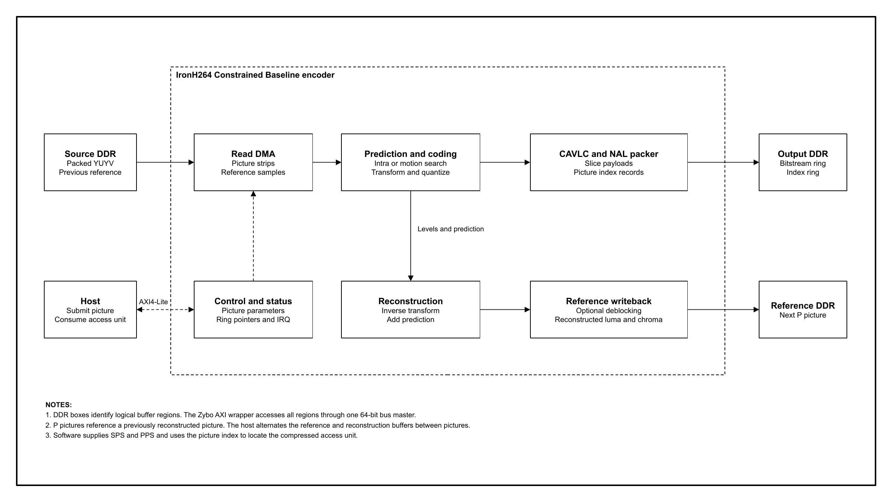

# IronH264 Specification

IronH264 is a bus-mastering H.264 Constrained Baseline encoder for FPGA video systems. It reads packed YUYV frames from DDR, reconstructs reference pictures and writes an indexed Annex B bitstream back to memory.

**Markdown design guide for AI-assisted integration.** Use the repository README with Claude or Codex to integrate the encoder RTL, allocate DDR buffers, and trace an encoded picture through firmware or the Linux driver.

| Interface | Contract |
|---|---|
| Input | Packed 8-bit YUYV 4:2:2 in addressable DDR |
| Coded video | Progressive 8-bit 4:2:0, intra/IDR and predicted P pictures, CAVLC entropy coding |
| Control | 32-bit AXI4-Lite register file with discovery, completion, interrupt and cycle counters |
| Zybo memory top | One engine, 64-bit AXI4 bus master, 32-bit byte addresses, independent control and encoder clocks |
| Output | Annex B NAL units, slice and picture index records, tiled reconstructed luma and chroma |
| Reference system | Zybo Z7-20 Linux with IronCapture DMA-BUF input and MPEG transport stream over UDP |

## Picture processing and stream assembly

Software submits a picture and supplies its sequence and picture parameter sets. The FPGA performs prediction, motion search, transform, quantization, entropy coding and reconstruction. Software can pass the compressed access unit to a recorder or network transport.

**Input and prediction.** A read DMA fetches strips of macroblocks from packed DDR rows. Each pixel pair arrives as Y0, Cb, Y1, Cr. The encoder passes luma through and averages chroma vertically over adjacent rows to form 4:2:0. Intra prediction uses the current picture. For P pictures, motion search reads the previous reconstructed picture and tests inter prediction.

**Coding and reconstruction.** The engine forms residuals, transforms and quantizes them, then codes the coefficients with CAVLC. The reconstruction path inverse-quantizes and inverse-transforms the retained levels, adds the prediction, and writes the reference that a decoder will reproduce. The optional in-loop deblocking filter operates on this reconstruction. I_PCM provides an exact-sample macroblock mode and a fallback for difficult blocks.

**Output ownership.** The packer assembles slice syntax and NAL units into the compressed ring. A separate index describes the byte ranges. Software supplies SPS/PPS consistent with the coded geometry, profile and cropping. It uses the picture record to assemble an access unit and marks IDR boundaries for the consumer.

| Implementation | Parallelism and memory interface |
|---|---|
| Configurable encoder top | One to four engines partition the picture into bands. The slice count must be a multiple of the engine count. The underlying memory interface supports 64- or 128-bit configurations. |
| Zybo AXI wrapper | One engine with a 64-bit AXI master. On the Linux reference, the 1080p30 configuration clocks HP3 and the encoder at 121.85 MHz. IronCapture writes the input independently on HP2. |

A 1920 × 1080 picture has 120 × 68 coded macroblocks. Picture rate depends on content, engine count, encoder clock, QP and memory service. The Linux reference submits each valid captured picture. Receiver timestamps give the delivered picture rate.

## DDR layout and ring protocol

| Region | Layout and ownership |
|---|---|
| Source | YUYV with two bytes per pixel. With the default four-macroblock strip, align the base and stride to 128 bytes. Provide a full final row of macroblocks. |
| Reconstructed luma | One 256-byte tile per 16 × 16 macroblock, in raster order. Base aligned to 256 bytes. |
| Reconstructed chroma | One 128-byte tile per macroblock, an 8 × 8 Cb block followed by an 8 × 8 Cr block. Base aligned to 128 bytes. |
| Reference | For P pictures, point to the previous reconstruction. Alternate reference and reconstruction buffers between pictures. |
| Compressed ring | Base aligned to 16 bytes. Total size is a multiple of 16 × engine count, with at least 1,024 bytes per engine. Published write progress follows successful bus responses. |
| Index ring | Base aligned to 128 bytes. Each 128-byte record starts with four little-endian words. Consume indexed byte ranges in order and handle ring wrap. |

| Visible frame | Coded grid | Required packed input at minimum stride | One reconstructed picture |
|---|---:|---:|---:|
| 1280 × 720 | 80 × 45 | 1,843,200 bytes | 1,382,400 bytes |
| 1920 × 1080 | 120 × 68 | 4,177,920 bytes | 3,133,440 bytes |

The 1080p source allocation accommodates 1,088 rows. The displayed crop remains 1,080 rows. Hold the source buffer through DMA completion and advance compressed and index read pointers after the consumer has copied or transmitted their contents. Ring pressure stalls the producer to protect unread data.

## Register interface

Byte offsets below are in the AXI4-Lite register window. Read capabilities at discovery and program picture configuration while idle.

| Offset | Registers and use |
|---|---|
| 0x000 / 004 / 008 | ID `0x48323634`, version, capabilities. CAPS identifies macroblock bounds, engine count, optional tools and implemented IRQ sources. |
| 0x00C | CTRL bit 0 starts a picture, bit 1 resets the rings and bit 8 gates the interrupt output. |
| 0x010 / 014 | STATUS reports BUSY, sticky DONE, sticky ERR and live RING_STALL. ERR_CODE retains the first error until acknowledged. |
| 0x020–03C | Macroblock width and height, slice count, quantizer, frame number, IDR picture ID, picture configuration and macroblock mode. |
| 0x040 / 044 | Packed source address and line stride in bytes. |
| 0x048 / 050 | Reconstructed luma and chroma bases. |
| 0x054 / 058 | Reference luma and chroma bases. |
| 0x060–070 | Compressed ring base, byte size, write offset, read offset and fill in bytes. |
| 0x078–088 | Index base, capacity in records, write index, read index and fill in records. |
| 0x090–0B0 | Picture, slice and macroblock counters, macroblock intervals, picture clocks and read/coding/write busy clocks. |
| 0x0C0–0C8 | Optional High Profile controls, status and transform counts on builds that expose them. Baseline reads zero. |
| 0x0D0 / 0D4 / 0D8 | IRQ status (write one to clear), source enables and software event injection. |
| 0x0E0 / 0E4 | Deblocking enable and signed alpha/beta offsets, with applied status on builds that include the filter. |

In Baseline builds IRQ bits 0, 1, 2 and 5 indicate picture done, error, ring-stall onset and picture start. Error codes identify invalid configuration (1), AXI response (2), invalid consumer pointer (3) and start while busy (4). Inspect STATUS before handing the picture to the consumer.

## Linux reference on Zybo Z7-20

The reference connects IronH264 at `0x43C40000` with GIC SPI 35. An application exports a completed IronCapture buffer and passes the DMA-BUF descriptor, width, height, stride, output pointer and capacity to `IRONH264_ENCODE` on `/dev/ironh264`. The caller retains ownership of the descriptor. The driver maps one contiguous DMA segment, starts the engine and returns the compressed length and keyframe flag.

The Linux adapter accepts 720p and 1080p at a stride of twice the width. Its reference settings are four slices, QP 28 and an IDR every 30 submitted pictures. It inserts parameter sets at IDR pictures. The standalone `ironforge-stream` application timestamps and packetizes the output as MPEG-TS over UDP for VLC.

### Physical camera over Gigabit Ethernet

The Pcam 5C supplied 1920 × 1080 YUYV video to a single encoder. During each run, the externally powered Zybo drove 1080p60 HDMI from DDR and read 1 GiB from USB storage. The receiver measured picture cadence from capture timestamps carried in MPEG-TS.

| Physical camera measurement | 90 MHz encoder | 121.85 MHz encoder |
|---|---:|---:|
| Pictures encoded / decoded | 1,800 / 1,800 | 1,800 / 1,800 |
| First-to-last timestamp span | 76.567 s | 59.967 s |
| Delivered pictures/s | 23.50 | **30.00** |
| H.264 elementary stream | 14.63 Mb/s | 20.45 Mb/s |
| MPEG-TS UDP payload | 15.04 Mb/s | 21.02 Mb/s |
| TS continuity errors / capture DMA errors | 0 / 0 | 0 / 0 |
| HDMI underruns / HDMI DDR read errors | 0 / 0 | 0 / 0 |

At 121.85 MHz, FFmpeg decoded 60 I pictures and 1,740 P pictures with its exit-on-error check enabled. The median picture interval was 33.333 ms and the longest was 33.722 ms. Bitrates are averages for the measured scene at QP 28.

## Verification and integration

| Check | What it establishes |
|---|---|
| Independent decoders | Recorded encoder regressions compare decoded pictures with the encoder’s reconstructed picture using JM, OpenH264 and FFmpeg. This checks reference management across I and P pictures. |
| Memory interface | The memory tests exercise burst formation, write responses, ring wrap and consumer backpressure. On a board, track RING_STALL separately from AXI errors. |
| Picture cadence | Divide encoder clock by PIC_CYC for the service rate of the measured picture. Compare against submitted pictures per second, using the selected QP and representative content. |
| Transport | An indexed access unit establishes a coded picture boundary. Confirm receiver continuity and decoder picture count after muxing, independently of encoder completion. |

A useful first system test is a repeating pattern with periodic IDRs. Compare submitted, completed and decoded picture counts. Then repeat with motion and fine texture while monitoring ring fill and picture clocks.

## Contact IronKernel

For an encoder integration, include the input format, resolution, frame rate, DDR interface and intended stream or recording format.

IronKernel provides FPGA design and design review, board bring-up, bare-metal firmware, embedded Linux drivers and application development. For integration support, a reference design or a custom development proposal, send your target board and project goal.

[IronKernel.com](https://ironkernel.com/) · [support@ironkernel.com](mailto:support@ironkernel.com)

